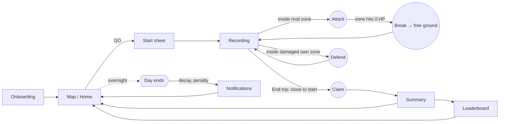

# PedalPace: Screens & User Flow

Target audience: **casual mixed-fitness players**, everyday walkers and commuter cyclists aged roughly 18 to 40. They want a reason to get outside, not a training plan. Mobile first, used outdoors, often glanced at mid-activity.

---

## 1. Core loop

**Every session:** Map → GO → Record → End trip → Summary → Leaderboard → Map.
**Every day:** the day rollover applies penalties and decay; notifications (including attacks by other players, which arrive live) pull the player back.

---

## 2. Screen list

| # | Screen | Purpose | Key elements |
|---|---|---|---|
| 1 | **Onboarding: Welcome** | Hook and core idea | Animated "route becomes territory" art, logo, tagline *Walk it. Ride it. Own it.* |
| 2 | **Onboarding: Attack & defend** | Teach the combat rule | Health-bar art, `Damage = distance × intensity`, walking vs cycling multipliers |
| 3 | **Onboarding: Stay active** | Set expectations about penalties | Penalty ladder −5 → −50 cap, daily minimum, rest token, streaks |
| 4 | **Onboarding: Sign in** *(online mode)* | Account | **Continue with Google** or **Play as a guest** (guests can link Google later) |
| 5 | **Onboarding: Make your player** | Identity and permissions | Name (pre-filled from Google), territory colour, **Allow location** (the map starts where you are) |
| 6 | **Map (home)** | See the board | Google-Maps-style map: **Satellite / Map / Dark** picker, blue location dot with accuracy circle and heading, re-centre. Real-shape zones with labels (name, owner, HP bar, HP number, *decaying* / *damaged* tags); tap a zone for a details card. Friends on a trip shown live. Points, streak, daily-minimum ring, sunlight toggle, bell, legend, **GO** button |
| 7 | **Start sheet** | Set up a trip | How claiming works, **GPS accuracy** status, mode **Auto / Walk / Cycle**, friends nearby (combo), **Start trip**. On localhost: *Test: draw a route and simulate it* |
| 8 | **Recording HUD** | Live feedback while moving | Big damage counter; distance, time, speed and **zone-if-you-end-now** area; context badge (*Attacking X* / *Defending Y* / *Free ground*); chips for mode, intensity ×, GPS ±m, streak ×, **COMBO ×**. On the map: trail in your colour, 🏁 start, dotted closing line back to the start, light preview fill, damage numbers popping. Anti-cheat banner, *ZONE BROKEN* banner, *back at your start* hint; pause, follow-me, **End trip** |
| 9 | **End-trip sheet** | Confirm the claim | Explains the straight closing line and the area you'll get (or why there's no zone); *Keep going* / *End & claim* |
| 10 | **Trip summary** | Payoff | 4 hero tiles: **Damage dealt · Zone (area, HP) · Points earned · Penalty avoided**. Points breakdown (base, streak, combo, defend, new ground, zones broken), territory events (broken, healed, cut around rivals), anti-cheat report, badges unlocked |
| 11 | **Leaderboards** | Social comparison | Tabs: Friends · Weekly damage · Territory · Everyone (top 50). Your row highlighted |
| 12 | **Friends** | Multiplayer | Your **friend code**, copy and *share invite link*; add by code; friends list (live "on a ride now", territory, points, show on map, remove); how playing together works |
| 13 | **Profile** | Long-term progress | Account card (Google, or guest with *Link Google account*). Total points, damage dealt, **points lost to inactivity**, streak / best, territory, rest tokens; **Today** card with *Use a rest token*; badges; recent trips. Settings: name, colour, map type, sunlight mode, notifications, sign out |
| 14 | **Notifications** | Re-engagement | *Your zone was hit / broken*, *zone lost to decay*, *friend added you*, *streak reminder*, *missed-day penalty*, *badge unlocked* |

---

## 3. Detailed flows

### 3.1 First run
1. Welcome → Attack & defend → Stay active (*Skip* jumps ahead) → Sign in (online mode) → Make your player.
2. **Let's go** opens the Map at your location, with a tip: *Tap GO to start your first trip.*
3. Opening an invite link (`?add=CODE`) adds that friend straight after sign-in.

### 3.2 Trip → attack / defend → claim → summary
1. **GO** opens the Start sheet. Check the GPS accuracy, pick a mode, then **Start trip**.
2. *GO!* banner (or *Waiting for accurate GPS…*). The map follows you and the trail is drawn in your colour, exactly as you move, on inner roads and paths too. A 🏁 marks the start, and a dotted line runs from you back to it.
3. While moving:
   * **Free ground:** `+N` numbers pop in your colour.
   * **Rival zone:** the context badge turns pink (*⚔ Attacking*), `⚔ N` numbers pop and the zone's HP bar drops live, for its owner too.
   * **Your damaged zone:** the context badge turns green (*🛡 Defending*) and the HP bar fills.
   * **Zone broken:** *ZONE BROKEN!* banner and the zone disappears; its ground is free.
   * **Back near the start:** toast *You're back at your start. Tap End trip now to claim the full loop.*
   * **Daily minimum reached:** toast *Daily minimum met. Tonight's −5 penalty avoided!*
   * **Anti-cheat:** red banner *"Walking" at 28 km/h. Damage paused*; the trail turns red and dashed. When the speed is back to normal: *Damage resumed*.
4. **End trip** opens the end-trip sheet. **End & claim**: the route is closed with a straight line to the start and filled. A semicircle becomes a filled half-circle. The Summary follows; *View map* flies to the new zone.

### 3.3 Daily cycle
* Days follow the real calendar. When you open the app on a new day, it applies a penalty for each missed day (unless a rest token covered it) and sends a morning streak reminder.
* Zones of players inactive for 2+ days decay, and a zone that decays to 0 HP disappears. Your next trip stops your zones decaying.

## 4. Visual & accessibility notes

* **Bold, game-like UI over a clean map.** Muted grey basemap with neon territory, glowing outlines and arcade-style banners.
* **Not colour-alone.** Every zone label shows the owner's name and an HP number as well as the bar. Decay is shown by a dashed outline *and* a "⏳ decaying" tag.
* **Sunlight mode** (☀ button, top bar). Light basemap, black-on-white panels with 2 px borders, darker territory colours, black HP bars, no glow. It's designed for direct sun, where glare washes out mid-tones.
* Large touch targets (≥ 44 px), 17 px base font, tabular numbers, high-contrast buttons.
* `prefers-reduced-motion` turns off popping numbers, pulses and banner animations.
* Live regions announce banners and toasts to screen readers.

---

## 5. Prototype vs production

| Area | Prototype | Production plan |
|---|---|---|
| GPS | Live browser GPS (`watchPosition`), Kalman-smoothed, resampled to 1 Hz, fixes worse than ±30 m dropped; simulated test routes on localhost | Native background location, so recording continues with the screen off |
| Accounts | Firebase Auth: Google or guest (offline mode without Firebase) | Same |
| Data | Cloud Firestore: profiles, friends, zones, live positions, notifications | Same, plus server-side trip re-validation (anti-cheat) |
| Heart rate | Not used for live trips | BLE HR straps / HealthKit / Health Connect |
| Days | Real calendar, applied when the app opens | Scheduled server job at midnight per timezone |
| Map | Leaflet with keyless Esri satellite, OpenStreetMap and Esri dark tiles | Same, or vector tiles with a custom style |

