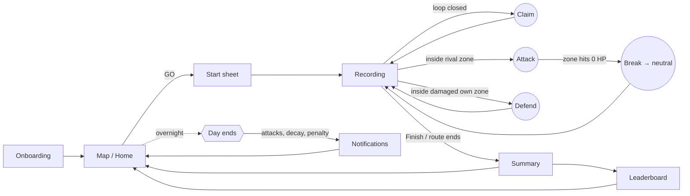

# PedalPace: Screens & User Flow

Target audience: **casual mixed-fitness players**, everyday walkers and commuter cyclists aged roughly 18 to 40. They want a reason to get outside, not a training plan. Mobile first, used outdoors, often glanced at mid-activity.

---

## 1. Core loop

**Every session:** Map → GO → Record → Summary → Leaderboard → Map.
**Every day:** an overnight tick applies penalties, decay and rival attacks, then notifications pull the player back.

---

## 2. Screen list

| # | Screen | Purpose | Key elements |
|---|---|---|---|
| 1 | **Onboarding: Welcome** | Hook and core idea | Animated "loop becomes territory" art, logo, tagline *Walk it. Ride it. Own it.* |
| 2 | **Onboarding: Attack & defend** | Teach the combat rule | Health-bar art, `Damage = distance × intensity`, walking vs cycling multipliers |
| 3 | **Onboarding: Stay active** | Set expectations about penalties | Penalty ladder −5 → −50 cap, daily minimum, rest token, streaks |
| 4 | **Onboarding: Make your player** | Identity and permissions | Name, territory colour (4 neon options), clan join / solo, HR monitor, notifications, location note |
| 5 | **Map (home)** | See the board | Live map with neon zones, zone labels (name, owner, HP bar, HP number, *decaying* / *damaged* tags), points, streak, daily-minimum ring, sunlight toggle, bell, legend, recentre, **GO** button |
| 6 | **Start sheet** | Set up an activity | Route list (prototype: simulated GPS), mode **Auto / Walk / Cycle**, group size, HR toggle, sim speed |
| 6b | **Draw-your-route** | Free testing | Tap waypoints on the map, speed slider, *Ride it* |
| 7 | **Recording HUD** | Live feedback while moving | Big damage counter, distance / time / speed / points, context badge (*Attacking X* / *Defending Y* / *Neutral ground*), chips for mode, intensity ×, HR zone, streak ×, **COMBO ×**, grade. Daily-minimum bar, damage numbers popping on the map, anti-cheat banner, *AREA CLAIMED* / *ZONE BROKEN* banners, pause / speed / finish |
| 8 | **Post-activity summary** | Payoff | 4 hero tiles: **Damage dealt · Area claimed · Points earned · Penalty avoided**. Points breakdown (base, streak, combo, defend, claim, break), territory events, anti-cheat report, badges unlocked |
| 9 | **Leaderboards** | Social comparison | Tabs: Friends · City · Weekly damage · Biggest territory · Clans. Your row highlighted |
| 10 | **Clan** | Team play | Clan territory, weekly damage, members. Shared zones with HP and a *defend →* shortcut that flies the map to the zone. How clans work |
| 11 | **Profile** | Long-term progress | Total points, damage dealt, **points lost to inactivity**, streak / best, territory, rest tokens, badges, recent activity, settings (sunlight mode, HR, notifications, colour) |
| 12 | **Notifications** | Re-engagement | *Under attack*, *zone decaying*, *zone lost*, *streak reminder*, *missed-day penalty*, *badge unlocked* |
| — | **Time machine** *(prototype only, in Profile)* | Test the daily systems | *Skip day (inactive)*, *Use rest token*, *End day* |

---

## 3. Detailed flows

### 3.1 First run
1. Welcome → Attack & defend → Stay active → Make your player (*Skip* jumps straight to step 4).
2. **Let's go** opens the Map, centred on home. A toast says *Home Turf is under attack! Tap GO and try "Defend patrol".* This gives the player an immediate goal.

### 3.2 Record → claim / attack → summary
1. **GO** opens the Start sheet. Pick a route and mode, then **Start**.
2. *GO!* banner. The map follows the player and the track is drawn in the player's colour.
3. While moving:
   * **Free roam / neutral:** `+N` numbers pop in the player's colour.
   * **Enemy zone:** context badge turns pink (*⚔ Attacking*), `⚔ N` numbers pop, and the zone's HP bar drops live.
   * **Damaged own zone:** context badge turns green (*🛡 Defending*) and the HP bar fills.
   * **Loop closed:** the area flashes white, then the *AREA CLAIMED · N cells · +pts* banner appears and the map repaints.
   * **Zone broken:** *ZONE BROKEN!* banner and the zone turns grey (neutral).
   * **Daily minimum reached:** toast *Daily minimum met. Tonight's −5 penalty avoided!*
   * **Anti-cheat:** red banner *"Walking" at 28 km/h. Damage paused*, and the track turns red and dashed. When the speed is back to normal: *Damage resumed*.
4. **Finish** (or the route ends) opens the Summary. From there, *View map* or *Leaderboard*.

### 3.3 Daily cycle
* Each night: penalty if the minimum wasn't met (unless a rest token is used), rival raids, and decay for inactive owners.
* Morning notifications explain what happened and what to do: *15 min walk stops the decay*.

---

## 4. Visual & accessibility notes

* **Bold, game-like UI over a clean map.** Muted grey basemap with neon territory, glowing outlines and arcade-style banners.
* **Not colour-alone.** Every zone label shows the owner's name and an HP number as well as the bar. Decay is shown by a dashed outline *and* a "⏳ decaying" tag.
* **Sunlight mode** (☀ button, top bar). Light basemap, black-on-white panels with 2 px borders, darker territory colours, black HP bars, no glow. It's designed for direct sun, where glare washes out mid-tones.
* Large touch targets (≥ 44 px), 17 px base font, tabular numbers, high-contrast buttons.
* `prefers-reduced-motion` turns off popping numbers, pulses and banner animations.
* Live regions announce banners and toasts to screen readers.

---

## 5. Prototype vs production

| Area | Prototype | Production plan |
|---|---|---|
| GPS | Simulated 1 Hz samples along scripted or drawn routes | `navigator.geolocation.watchPosition` / native background location. The recorder API is the same, so it's a drop-in swap |
| Heart rate | Modelled from speed and grade | BLE HR straps / HealthKit / Health Connect |
| Rivals | 3 scripted bots (Mira, Vex, Kai) + static leaderboard NPCs | Real players, server-side territory |
| Days | *Time machine* button | Real midnight in the player's timezone |
| Storage | `localStorage` | Backend with server-side anti-cheat re-validation |
| Map | Leaflet + Esri Canvas basemap tiles | Same, or vector tiles with a custom style |
